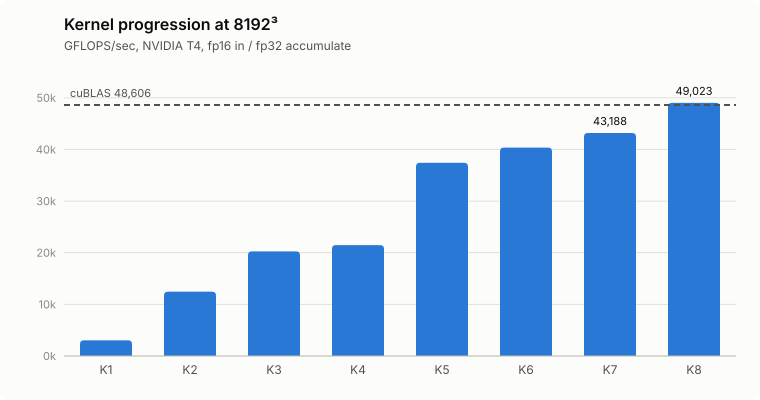
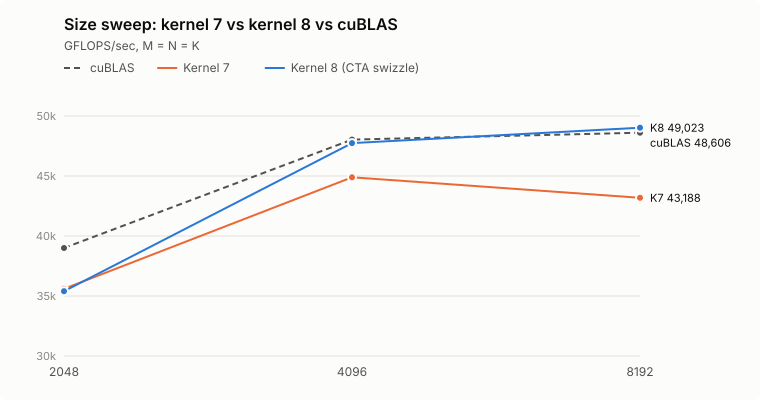

# MMA Benchmark on T4 GPU

A step-by-step implementation of CUDA matrix multiply-accumulate (MMA) kernels using **CuTe**, progressively optimized toward cuBLAS performance.

worklog: [here](https://chamgeon.github.io/2026/07/19/CuTeMMA.html)

All benchmarks run on an **NVIDIA T4 GPU** with matrix size **8192×8192×8192**.

---

## Results

| Kernel | Optimization | GFLOPS/sec | vs Previous | vs cuBLAS |
|--------|-------------|------------|-------------|-----------|
| 1 | Naive | 3,036.3 | — | 6.2% |
| 2 | Tiled copy + tiled MMA (vectorized) | 12,453.8 | +310% | 25.6% |
| 3 | Swizzle | 20,256.5 | +63% | 41.7% |
| 4 | Explicit register buffer for copy | 21,472.6 | +6.0% | 44.2% |
| 5 | Arithmetic intensity improvement | 37,423.8 | +74% | 77.0% |
| 6 | LDSM pipelining + MMA tile size fix | 40,365.1 | +7.9% | 83.0% |
| 7 | 2-stage pipelining | 43,187.5 | +7.0% | 88.9% |
| 8 | CTA swizzle | 49,023.0 | +13.5% | **100.9%** |
| cuBLAS | Reference | 48,606.5 | — | 100% |

Kernel 8 **matches cuBLAS** at 8192³ (100.9%, within run-to-run noise). All numbers are from a single `./sweep.sh` session ([`sweep.csv`](sweep.csv)).

<picture>
  <source media="(prefers-color-scheme: dark)" srcset="assets/progression_dark.svg">
  
</picture>

### Size sweep

| Size (M=N=K) | Kernel 7 | Kernel 8 | cuBLAS | Kernel 8 vs cuBLAS |
|---|---|---|---|---|
| 2048 | 35,599.5 | 35,399.1 | 38,997.7 | 90.8% |
| 4096 | 44,895.8 | 47,741.8 | 48,030.7 | 99.4% |
| 8192 | 43,187.5 | 49,023.0 | 48,606.5 | 100.9% |

<picture>
  <source media="(prefers-color-scheme: dark)" srcset="assets/sweep_dark.svg">
  
</picture>

- **CTA swizzle pays off as the problem grows.** Kernel 7 *slows down* from 4096 to 8192 because concurrently running CTAs share almost no A tiles, so A is re-read from DRAM. Kernel 8's grouped CTA order restores L2 reuse: +6.3% at 4096, +13.5% at 8192.
- **2048 is limited by wave quantization.** With 128×256 tiles and 1 CTA/SM, 2048³ launches 128 CTAs on 40 SMs: 3.2 waves, so the last wave leaves ~80% of SMs idle. cuBLAS likely switches to smaller tiles here.
- **1024 is omitted.** A 1024³ GEMM takes ~0.08 ms, so per-launch event timing is dominated by launch/host overhead (cuBLAS's included); those numbers are in `sweep.csv` but not comparable.

---

## Kernel Descriptions

**Kernel 1 — Naive**
Baseline implementation with no optimization. Each thread computes a single output element with no memory reuse.

**Kernel 2 — Tiled Copy + Tiled MMA (Vectorized)**
Applies CuTe tiled copy and tiled MMA abstractions with vectorized memory access, yielding a 4× improvement over the naive baseline.

**Kernel 3 — Swizzle**
Applies swizzled shared memory layout to eliminate bank conflicts, significantly improving memory throughput.

**Kernel 4 — Explicit Register Buffer for Copy**
Introduces explicit register-level buffering during the copy phase to reduce redundant memory traffic.

**Kernel 5 — Arithmetic Intensity Improvement**
Analyzes and improves arithmetic intensity by restructuring computation to maximize FLOP-per-byte ratio, resulting in a 74% jump in performance.

**Kernel 6 — LDSM Pipelining + MMA Tile Size Fix**
Applies `ldsm` instruction-level pipelining and fixes the MMA tile size to reduce the number of `ldsm` calls, improving instruction efficiency.

**Kernel 7 — 2-Stage Pipelining**
Introduces double-buffering (2-stage pipeline) to overlap data loading and computation, hiding memory latency and reaching 89% of cuBLAS throughput.

**Kernel 8 — CTA Swizzle**
Same as kernel 7, but remaps `blockIdx` so that consecutively launched CTAs cover a `GROUP_M`×N patch of output tiles (`GROUP_M = 8`) instead of a single tile column. Concurrently running CTAs then share A and B tiles through L2, reducing DRAM traffic at large sizes. CUDA does not guarantee CTA scheduling order, so this only affects performance, never correctness.

---

## Usage

### Build

```bash
make -j4    # parallel build; only changed files recompile
```

### Run

```bash
./runner <kernel_number>

# Examples
./runner 1    # Naive kernel
./runner 7    # 2-stage pipelining kernel
./runner 8    # CTA swizzle kernel
./runner 99   # cuBLAS reference

# Optional problem size (M=N=K): 1024, 2048, 4096, 8192 (default 8192)
./runner 7 2048
```

### Size sweep

```bash
./sweep.sh > sweep.csv                       # all kernels x all sizes, CSV output
KERNELS="7 99" SIZES="2048 8192" ./sweep.sh  # subset
```

Sizes are compile-time template parameters, so each size gets the same fully static layouts as the original 8192 build.

### Dependencies

- CUDA Toolkit
- [CUTLASS](https://github.com/NVIDIA/cutlass)
- cuBLAS